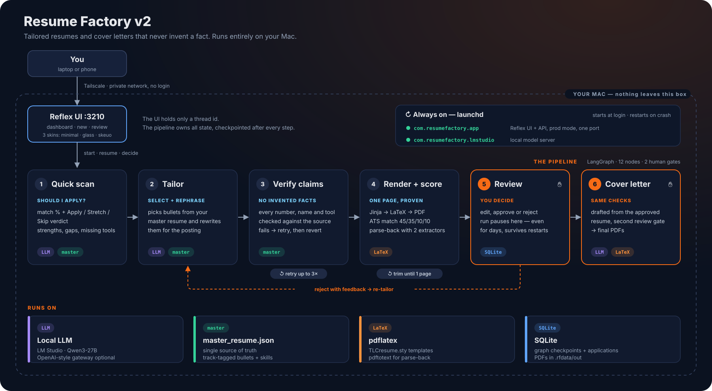

# Resume Factory v2

Local-first tailored resume and cover letter generation. Reflex front end, LangGraph
state machine with two human review gates, SQLite for both application records and
graph checkpoints.

## Demo

https://github.com/user-attachments/assets/6d7bb3dc-ee9c-49b1-9f2c-01ffbf5eba4b

## Architecture

## What it guarantees

The model may **select and rephrase** bullets from `data/master_resume.json`. It may not
add facts. Every rephrased bullet is checked against its source: any number or named
entity present in the rewrite but absent from the source (and absent from the declared
skill pool) is a violation, and so is naming a posting tool that appears nowhere in the
master resume (`dbt` for someone who has never used it) or dropping a tool or number the
source had. The objective and the cover letter get the same checks. Violations force a
retry; if retries run out, the offending text falls back to the approved source and the
violations are shown.

No applicant tracking system emits a score, so the numbers here are proxies with their
working shown:

- **Quick scan** - paste a posting before generating anything and get a match %, an
  Apply / Stretch / Skip verdict, strengths, gaps and the tools you lack.
- **ATS match** - after generation: 45% posting tools found on the resume, 35%
  requirement keywords (stemmed, filler words excluded), 10% job title, 10% clean
  parse. Tools you have never used cap it, and the review page lists them.
- **Parse-back** - text is extracted from the generated PDF with two different
  extractors and checked for name, employers, dates and schools. `spacing risk` warns
  when a lenient parser merges words.

The dashboard tallies applications, waiting, interviews and rejections from the
outcome you set on each row.

## Setup

    uv sync
    cp .env.example .env      # point RF_LMSTUDIO_* at your local server
    uv run reflex run

Requires a LaTeX install with `pdflatex` (MacTeX), plus the
`sourcesanspro` package. `pdftotext` (poppler) improves the parse-back check but is
optional.

Diagnose a model that returns empty or malformed responses -- dumps the raw HTTP
reply four ways (plain, thinking off, JSON schema, both):

    uv run python -m rfactory.probe

Measure where generation time goes, with and without the reasoning phase:

    uv run python -m rfactory.bench

Check everything that has to be true before a real run -- LaTeX packages, LM Studio
reachability, whether the configured model is actually loaded:

    uv run python -m rfactory.doctor

Check the mechanical path without any model:

    uv run python -m rfactory.smoke data_eng

Run the graph tests (stubbed model, real LaTeX):

    uv run pytest

## Running it from anywhere

The app stays on this Mac and is reached over Tailscale. Nothing is deployed, no LaTeX
is containerised, the local model keeps working, and no resume data leaves the machine.

    ./serve.sh

That reads your Tailscale name, exports it as `RF_PUBLIC_HOST`, and keeps the Mac awake
with `caffeinate -i` for as long as the server runs. Then open `http://<your-mac>.<tailnet>.ts.net:3210`
from any device signed in to your tailnet.

Why the hostname matters: Reflex compiles `api_url` into the frontend bundle. Left at
`localhost`, a phone loading the app dials *its own* localhost -- no websocket, no PDF
preview, and no error message explaining why. `serve.sh` exists to make that impossible
to get wrong. Access control is the tailnet itself; there is no app-level login,
because a password on top of a private network is theatre.

Caveat: the Mac has to be awake and on the tailnet. If it sleeps, the app is gone.

## Using a gateway instead of LM Studio directly

Set `RF_LLM_PROVIDER=gateway` and point `RF_GATEWAY_BASE_URL` at an OpenAI-compatible
router. With OmniRoute (`http://127.0.0.1:20128/v1`), put LM Studio in tier 1 so free
cloud providers are only reached when local is unavailable.

The gateway owns routing, fallback, load balancing and rate-limit handling. This app
deliberately does not reimplement any of it -- it points at one base URL and lets the
router route. `python -m rfactory.doctor` will list the models the gateway exposes if
the configured one is not among them.

Worth deciding consciously: every tailored resume sent through a free-tier provider
includes your employment history, phone and email, and the JD says where you are
applying. Local inference does not have that property.

## Layout

    data/master_resume.json   single source of truth; track tags decide what appears
    templates/                resume.tex.j2 + TLCresume.sty, cover/ for the letter
    rfactory/graph/           nodes and the compiled state machine
    rfactory/scoring/         claim verification, JD coverage, parse-back
    rfactory/render/          Jinja to LaTeX, pdflatex, one-page trim loop
    serve.sh                  start on the tailnet, awake, with the right host baked in
    .rfdata/                  generated PDFs and the SQLite database (gitignored)
